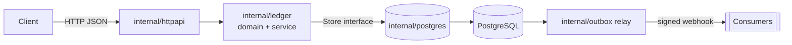
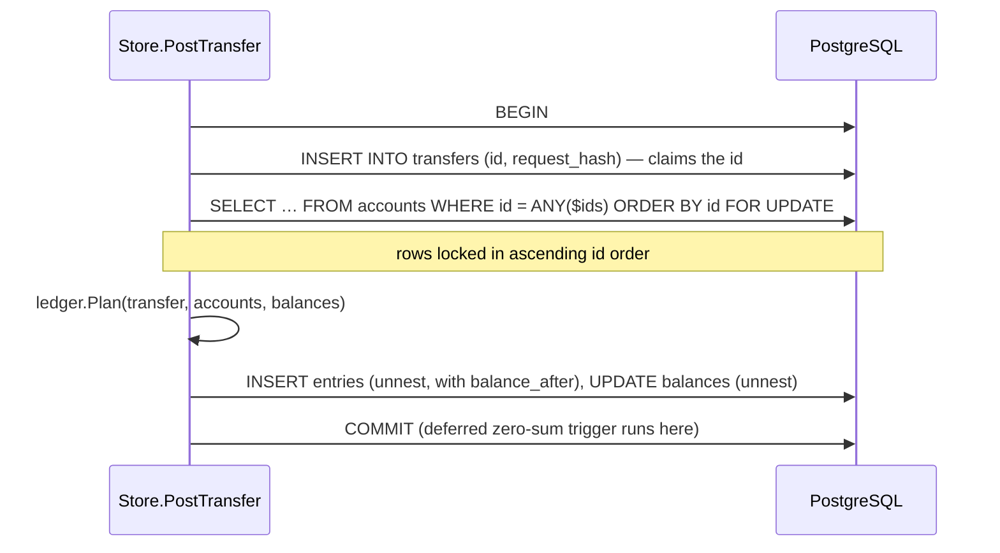
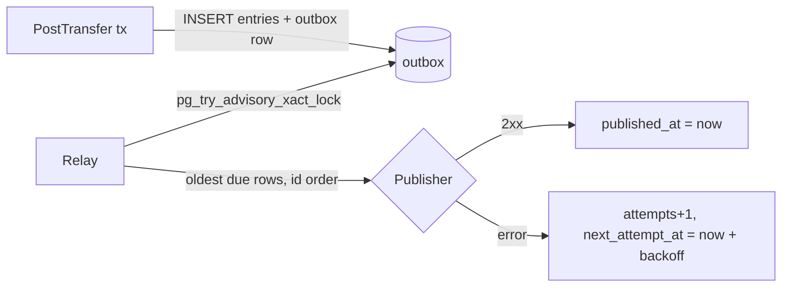

<div align="center">

# go-ledger

**A double-entry wallet & ledger service in Go: correct balances, no double charges, no lost events.**

[](https://github.com/Nguyenngoctruong274/go-ledger/actions/workflows/ci.yml)


</div>

## Why

Every product that moves money (ride-hailing wallets, e-commerce refunds, loyalty points) eventually hits the same bugs: balances that drift, a retried request that charges twice, an event that never reaches downstream services. `go-ledger` is a compact, production-style service that solves those problems explicitly.

## Design goals

| Problem | Approach |
|---|---|
| Balances drift | Double-entry bookkeeping: every transfer writes entries that sum to zero, enforced in one constructor |
| Concurrent transfers corrupt balances | Postgres transactions with row locks taken in a deterministic order (no deadlocks) |
| Client retries charge twice | `Idempotency-Key` stored in the same transaction as the entries |
| Events lost on crash | Transactional outbox + relay |
| Floating-point money | `int64` minor units only |

## Architecture



Packages are organized by responsibility, not by layer. The `ledger` package owns the business rules and defines the `Store` interface it needs; `postgres` implements it.

## Domain model

| Type | Rule |
|---|---|
| `Amount` | Signed `int64` minor units. Negative debits an account, positive credits it. Additions are overflow-checked. |
| `Transfer` | Built only through `NewTransfer` / `NewPayment`: ≥ 2 entries, non-zero amounts, each account once, one currency, **sum = 0**. Fields are unexported, so a balanced transfer cannot be unbalanced later. |
| `Account` | Holds currency and `AllowNegative` (true only for system accounts such as funding or settlement). |
| `Plan` | Pure check of a transfer against current balances: unknown account, currency mismatch, insufficient funds. Returns the new balances without mutating anything; the store applies them inside the DB transaction. |

```go
// Ride payment: rider pays 30,000 VND, driver gets 24,000, platform keeps 6,000.
t, err := ledger.NewTransfer("ride-42", "VND",
    ledger.Entry{AccountID: "rider", Amount: -30_000},
    ledger.Entry{AccountID: "driver", Amount: 24_000},
    ledger.Entry{AccountID: "platform-fee", Amount: 6_000},
)
```

The zero-sum invariant is covered by table tests and a fuzz test (`go test -fuzz=FuzzNewTransfer ./internal/ledger`).

## Storage

Schema lives in [`internal/postgres/migrations`](internal/postgres/migrations) and is embedded in the binary. `ledgerd` applies pending migrations on startup under a `pg_advisory_lock`, so several replicas can start at once; each migration runs in its own transaction.

The database enforces the ledger rules a second time, independently of the Go code:

| Safeguard | How |
|---|---|
| Transfers balance | Deferred constraint trigger: at commit, the entries of every touched transfer must sum to 0 |
| No overdraft on customer accounts | `CHECK (allow_negative OR balance >= 0)` |
| Ledger is append-only | Trigger rejects `UPDATE` / `DELETE` on `entries` |
| One entry per account per transfer | `UNIQUE (transfer_id, account_id)` |
| Fast statements | Index `(account_id, id DESC)` + keyset pagination |

Driver: `database/sql` with [`lib/pq`](https://github.com/lib/pq).

## Posting a transfer

`Store.PostTransfer` applies a validated transfer in a single database transaction:



**Why the lock order matters.** If one request moves money A→B while another moves B→A, and each locks its source account first, each ends up waiting for the other: a deadlock, and Postgres aborts one of them. Locking every account in the same global order (ascending id) turns that into a short queue. `TestPostTransferOppositeDirectionsDoNotDeadlock` runs 100 opposite-direction transfers concurrently; with unordered locking it fails with `pq: deadlock detected`, with ordered locking all of them succeed.

**Concurrency test.** `TestPostTransferConcurrentInvariants` runs 320 random transfers across 8 workers, many of them larger than the sender's balance, and then checks that money is conserved, no customer wallet is negative, and each stored balance equals the sum of its entries.

## Idempotency

Clients retry: a mobile app times out, a queue redelivers, a user taps twice. The transfer id is the idempotency key, and `PostTransfer` makes retries safe:

| Request | Result |
|---|---|
| New id | Posted. Receipt with `Replayed = false`. |
| Same id, same request | Nothing moves. The original receipt comes back with `Replayed = true`, even if the balance has changed since. |
| Same id, different request | `ErrIdempotencyConflict` (will map to HTTP 422). |

"Same request" is decided by `Transfer.Fingerprint()`: a SHA-256 over the currency and the sorted `(account, amount)` entries, stored in `transfers.request_hash`. Entry order and the id do not affect it.

Two identical requests arriving at the same moment are handled by the order of operations inside the transaction: the transfer row is inserted **before** funds are checked. The second request blocks on the primary key, gets a unique violation once the first commits, and replays its receipt. If funds were checked first, the second request would see the balance the first one just spent and wrongly report insufficient funds. `TestPostTransferConcurrentRetries` fires 20 identical requests at once and requires exactly one post and 19 replays; with the steps swapped it fails.

Each entry also stores `balance_after`, so replays and account statements show running balances without recomputing history. Migration `0002` backfills it for existing rows with a window function.

## HTTP API

| Method | Path | Description |
|---|---|---|
| `POST` | `/v1/accounts` | Create an account `{id, currency, allow_negative}` |
| `GET` | `/v1/accounts/{id}` | Account with current balance |
| `GET` | `/v1/accounts/{id}/entries?limit=&before=` | Statement, newest first, keyset-paginated via `next_before` |
| `POST` | `/v1/transfers` | Post a transfer. **Requires `Idempotency-Key`**, which becomes the transfer id |
| `GET` | `/healthz` | Liveness |

```bash
curl -X POST localhost:8080/v1/transfers \
  -H 'Idempotency-Key: ride-42' \
  -d '{"currency":"VND","entries":[
        {"account_id":"rider","amount":-30000},
        {"account_id":"driver","amount":24000},
        {"account_id":"platform-fee","amount":6000}]}'
```

A simple payment can use the shorthand `{"currency":"VND","from":"rider","to":"driver","amount":30000}`.

The first call returns `201 Created` with the receipt (each entry with its `balance_after`). Repeating the same request returns `200 OK`, the identical body and `Idempotent-Replayed: true`.

Errors share one shape, with a stable `code` for programs:

```json
{"error": {"code": "insufficient_funds", "message": "transfer ride-2: insufficient funds: account rider has 20000, needs 999999"}}
```

| Status | `code` |
|---|---|
| 400 | `invalid_request`, `invalid_currency`, `unbalanced_transfer`, `too_few_entries`, `zero_amount`, `non_positive_amount`, `duplicate_account`, `amount_overflow`, `missing_id` |
| 402 | `insufficient_funds` |
| 404 | `account_not_found` |
| 409 | `account_exists` |
| 422 | `idempotency_conflict`, `currency_mismatch` |
| 500 | `internal`: details are logged, never returned |

Requests are limited to 1 MiB, must be a single JSON object and may not contain unknown fields. Amounts are integers in minor units; clients in JavaScript should treat values above 2^53 as strings. There is no authentication yet, so messages include balances; put the service behind an authenticating gateway.

The handlers depend on a small `Ledger` interface defined in `httpapi`, so they are tested against an in-memory fake (`go test ./internal/httpapi`), including the full error table.

## Events (transactional outbox)

Every posted transfer emits a `transfer.posted` event. Writing it directly to a broker from the request would either lose events (crash after commit, before publish) or announce transfers that rolled back (publish before commit). Instead the event is inserted into the `outbox` table **in the same transaction** as the entries, so it exists if and only if the money moved. Replays and rejected transfers write nothing.

A relay goroutine inside `ledgerd` then publishes pending rows:



| Property | How |
|---|---|
| At-least-once | A row is marked published only after the publisher confirms. A crash in between republishes it, so consumers dedupe on `X-Ledger-Message-Id` or `transfer_id`. |
| Ordered per account | One relay publishes at a time (advisory lock, safe with many replicas) and stops at the first failing or not-yet-due row. Transfers on a shared account get outbox ids in commit order because the row is written after the account lock. |
| Retries | Exponential backoff from 1 s to 5 min; `attempts` and `last_error` stay on the row for alerting. A message that keeps failing blocks those behind it by design. |

Publishers: a **signed webhook** (`X-Ledger-Signature: sha256=HMAC(secret, "<timestamp>.<body>")`, plus `X-Ledger-Timestamp`, `X-Ledger-Topic`, `X-Ledger-Message-Id`; any non-2xx is retried) or, when no URL is configured, the log. A Kafka publisher only needs to implement `outbox.Publisher`.

```json
{"transfer_id":"topup-1","currency":"VND","posted_at":"2026-10-15T08:31:42.951499Z",
 "entries":[{"account_id":"funding","amount":-50000,"balance_after":-50000},
            {"account_id":"rider","amount":50000,"balance_after":50000}]}
```

Tests cover the atomic write, in-order delivery, backoff without overtaking, four concurrent relays publishing 300 messages exactly once and in order, graceful stop, and webhook signing, status handling and timeouts.

## Quick start

```bash
make up       # start Postgres
make run      # start ledgerd on :8080 (applies migrations)
curl -X POST localhost:8080/v1/accounts -d '{"id":"alice","currency":"VND"}'
make test-db  # run tests, including the PostgreSQL ones
```

| Variable | Default | Description |
|---|---|---|
| `LEDGER_HTTP_ADDR` | `:8080` | Listen address |
| `LEDGER_DATABASE_URL` | – (required) | Postgres connection string |
| `LEDGER_SHUTDOWN_TIMEOUT` | `15s` | Graceful shutdown deadline |
| `LEDGER_LOG_LEVEL` | `info` | `debug`, `info`, `warn`, `error` |
| `LEDGER_OUTBOX_WEBHOOK_URL` | – | Where outbox events are POSTed. Unset: events are logged |
| `LEDGER_OUTBOX_WEBHOOK_SECRET` | – | HMAC key for webhook signatures (≥ 16 bytes, required with a URL) |

## Roadmap

- [x] Day 1: project skeleton, config, health check, graceful shutdown, CI
- [x] Day 2: domain model (accounts, transfers, entries) + invariant tests
- [x] Day 3: migrations + Postgres store
- [x] Day 4: transactional transfers with ordered row locks
- [x] Day 5: idempotency keys
- [x] Day 6: HTTP API + error mapping
- [x] Day 7: transactional outbox relay
- [ ] Day 8: integration tests with Testcontainers
- [ ] Day 9: observability (slog, Prometheus metrics, readiness)
- [ ] Day 10: Docker Compose stack, benchmarks, final docs

## License

MIT
