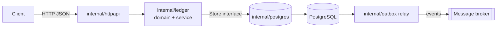
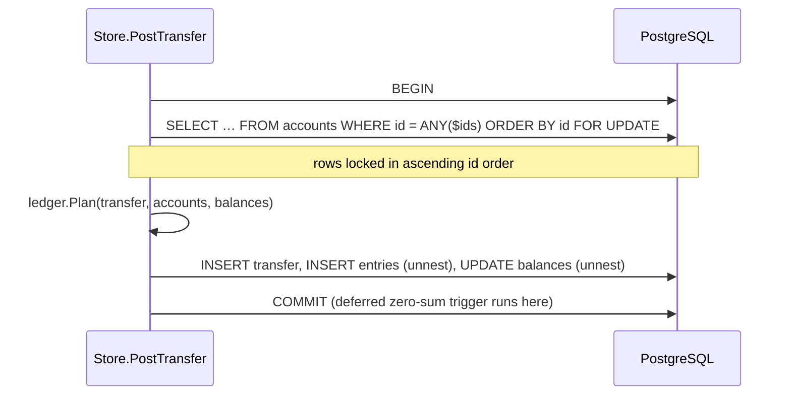

<div align="center">

# go-ledger

**A double-entry wallet & ledger service in Go: correct balances, no double charges, no lost events.**

[](https://github.com/Nguyenngoctruong274/go-ledger/actions/workflows/ci.yml)


</div>

## Why

Every product that moves money (ride-hailing wallets, e-commerce refunds, loyalty points) eventually hits the same bugs: balances that drift, a retried request that charges twice, an event that never reaches downstream services. `go-ledger` is a compact, production-style service that solves those problems explicitly.

## Design goals

| Problem | Approach |
|---|---|
| Balances drift | Double-entry bookkeeping: every transfer writes entries that sum to zero, enforced in one constructor |
| Concurrent transfers corrupt balances | Postgres transactions with row locks taken in a deterministic order (no deadlocks) |
| Client retries charge twice | `Idempotency-Key` stored in the same transaction as the entries |
| Events lost on crash | Transactional outbox + relay |
| Floating-point money | `int64` minor units only |

## Architecture



Packages are organized by responsibility, not by layer. The `ledger` package owns the business rules and defines the `Store` interface it needs; `postgres` implements it.

## Domain model

| Type | Rule |
|---|---|
| `Amount` | Signed `int64` minor units. Negative debits an account, positive credits it. Additions are overflow-checked. |
| `Transfer` | Built only through `NewTransfer` / `NewPayment`: ≥ 2 entries, non-zero amounts, each account once, one currency, **sum = 0**. Fields are unexported, so a balanced transfer cannot be unbalanced later. |
| `Account` | Holds currency and `AllowNegative` (true only for system accounts such as funding or settlement). |
| `Plan` | Pure check of a transfer against current balances: unknown account, currency mismatch, insufficient funds. Returns the new balances without mutating anything; the store applies them inside the DB transaction. |

```go
// Ride payment: rider pays 30,000 VND, driver gets 24,000, platform keeps 6,000.
t, err := ledger.NewTransfer("ride-42", "VND",
    ledger.Entry{AccountID: "rider", Amount: -30_000},
    ledger.Entry{AccountID: "driver", Amount: 24_000},
    ledger.Entry{AccountID: "platform-fee", Amount: 6_000},
)
```

The zero-sum invariant is covered by table tests and a fuzz test (`go test -fuzz=FuzzNewTransfer ./internal/ledger`).

## Storage

Schema lives in [`internal/postgres/migrations`](internal/postgres/migrations) and is embedded in the binary. `ledgerd` applies pending migrations on startup under a `pg_advisory_lock`, so several replicas can start at once; each migration runs in its own transaction.

The database enforces the ledger rules a second time, independently of the Go code:

| Safeguard | How |
|---|---|
| Transfers balance | Deferred constraint trigger: at commit, the entries of every touched transfer must sum to 0 |
| No overdraft on customer accounts | `CHECK (allow_negative OR balance >= 0)` |
| Ledger is append-only | Trigger rejects `UPDATE` / `DELETE` on `entries` |
| One entry per account per transfer | `UNIQUE (transfer_id, account_id)` |
| Fast statements | Index `(account_id, id DESC)` + keyset pagination |

Driver: `database/sql` with [`lib/pq`](https://github.com/lib/pq).

## Posting a transfer

`Store.PostTransfer` applies a validated transfer in a single database transaction:



**Why the lock order matters.** If one request moves money A→B while another moves B→A, and each locks its source account first, each ends up waiting for the other: a deadlock, and Postgres aborts one of them. Locking every account in the same global order (ascending id) turns that into a short queue. `TestPostTransferOppositeDirectionsDoNotDeadlock` runs 100 opposite-direction transfers concurrently; with unordered locking it fails with `pq: deadlock detected`, with ordered locking all of them succeed.

**Concurrency test.** `TestPostTransferConcurrentInvariants` runs 320 random transfers across 8 workers, many of them larger than the sender's balance, and then checks that money is conserved, no customer wallet is negative, and each stored balance equals the sum of its entries.

## Quick start

```bash
make up       # start Postgres
make run      # start ledgerd on :8080 (applies migrations)
curl localhost:8080/healthz
make test-db  # run tests, including the PostgreSQL ones
```

| Variable | Default | Description |
|---|---|---|
| `LEDGER_HTTP_ADDR` | `:8080` | Listen address |
| `LEDGER_DATABASE_URL` | – (required) | Postgres connection string |
| `LEDGER_SHUTDOWN_TIMEOUT` | `15s` | Graceful shutdown deadline |
| `LEDGER_LOG_LEVEL` | `info` | `debug`, `info`, `warn`, `error` |

## Roadmap

- [x] Day 1: project skeleton, config, health check, graceful shutdown, CI
- [x] Day 2: domain model (accounts, transfers, entries) + invariant tests
- [x] Day 3: migrations + Postgres store
- [x] Day 4: transactional transfers with ordered row locks
- [ ] Day 5: idempotency keys
- [ ] Day 6: HTTP API + error mapping
- [ ] Day 7: transactional outbox relay
- [ ] Day 8: integration tests with Testcontainers
- [ ] Day 9: observability (slog, Prometheus metrics, readiness)
- [ ] Day 10: Docker Compose stack, benchmarks, final docs

## License

MIT
