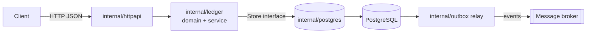

<div align="center">

# go-ledger

**A double-entry wallet & ledger service in Go: correct balances, no double charges, no lost events.**

[](https://github.com/Nguyenngoctruong274/go-ledger/actions/workflows/ci.yml)


</div>

## Why

Every product that moves money (ride-hailing wallets, e-commerce refunds, loyalty points) eventually hits the same bugs: balances that drift, a retried request that charges twice, an event that never reaches downstream services. `go-ledger` is a compact, production-style service that solves those problems explicitly.

## Design goals

| Problem | Approach |
|---|---|
| Balances drift | Double-entry bookkeeping: every transfer writes entries that sum to zero, enforced in one constructor |
| Concurrent transfers corrupt balances | Postgres transactions with row locks taken in a deterministic order (no deadlocks) |
| Client retries charge twice | `Idempotency-Key` stored in the same transaction as the entries |
| Events lost on crash | Transactional outbox + relay |
| Floating-point money | `int64` minor units only |

## Architecture



Packages are organized by responsibility, not by layer. The `ledger` package owns the business rules and defines the `Store` interface it needs; `postgres` implements it.

## Quick start

```bash
make up      # start Postgres
make run     # start ledgerd on :8080
curl localhost:8080/healthz
```

| Variable | Default | Description |
|---|---|---|
| `LEDGER_HTTP_ADDR` | `:8080` | Listen address |
| `LEDGER_DATABASE_URL` | – | Postgres connection string |
| `LEDGER_SHUTDOWN_TIMEOUT` | `15s` | Graceful shutdown deadline |
| `LEDGER_LOG_LEVEL` | `info` | `debug`, `info`, `warn`, `error` |

## Roadmap

- [x] Day 1: project skeleton, config, health check, graceful shutdown, CI
- [ ] Day 2: domain model (accounts, transfers, entries) + invariant tests
- [ ] Day 3: migrations + Postgres store
- [ ] Day 4: transactional transfers with ordered row locks
- [ ] Day 5: idempotency keys
- [ ] Day 6: HTTP API + error mapping
- [ ] Day 7: transactional outbox relay
- [ ] Day 8: integration tests with Testcontainers
- [ ] Day 9: observability (slog, Prometheus metrics, readiness)
- [ ] Day 10: Docker Compose stack, benchmarks, final docs

## License

MIT
